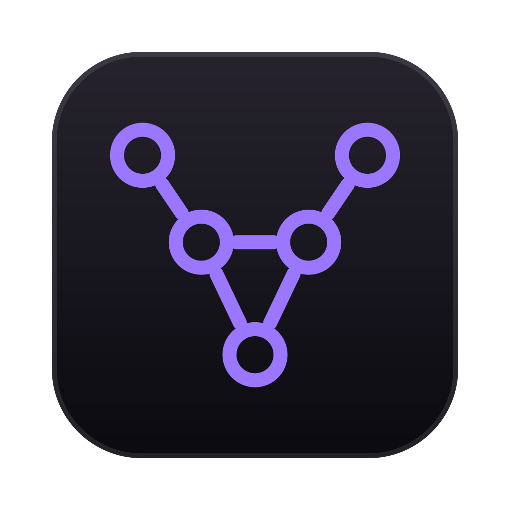

<div align="center">
	<h1>GitYak</h1>
	
	<h2>Cross-platform GUI for Git.</h2>
	<p><a href="https://gityak.com">gityak.com</a> · <a href="https://gityak.com/#download">Download</a> · <a href="https://gityak.com/changelog.html">Changelog</a></p>
</div>


About
---------------

Born out of necessity.

Like many of you, I love the visual workflow of tools like GitKraken. But I faced a major limitation: the inability to work on remote servers. I watched a feature request for this functionality gather dust [for 5 years and almost ~~500 votes~~ **600 votes**](https://feedback.gitkraken.com/suggestions/223779/repository-management-on-remote-machine-using-ssh-connection)... it is still "Under consideration" 😴

Enough was enough. I decided to stop waiting and start building. This project is the result-a modern, web-based Git GUI designed from the ground up to handle both local and remote repositories seamlessly.


Releasing
---------------

```sh
yarn release 2.1.0          # sets the version everywhere, commits, creates the annotated tag v2.1.0
git push --follow-tags      # GitHub Actions builds every installer and publishes it to gityak.com
```

The tag message becomes the release notes, shown on the website and in the app's update notice.
Tags with a pre-release suffix (`v2.1.0-beta.1`) are published but never offered as an update.
The workflow needs the repository secrets `DEPLOY_SSH_KEY` and `DEPLOY_KNOWN_HOSTS`.
